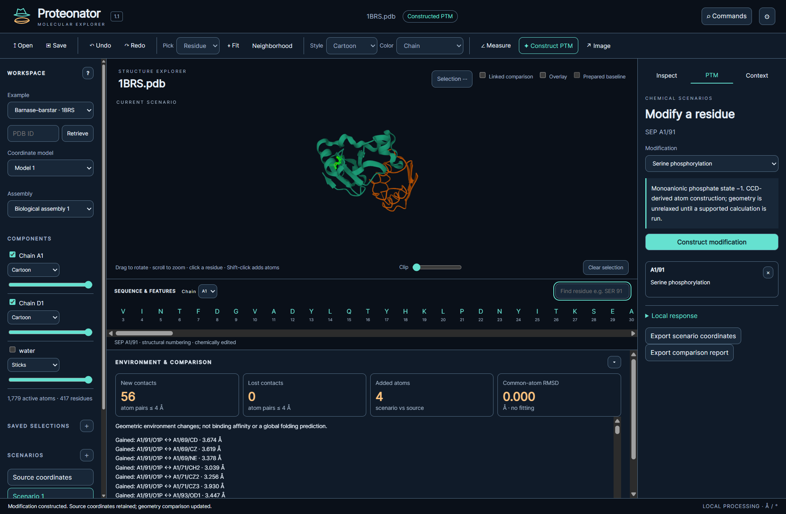
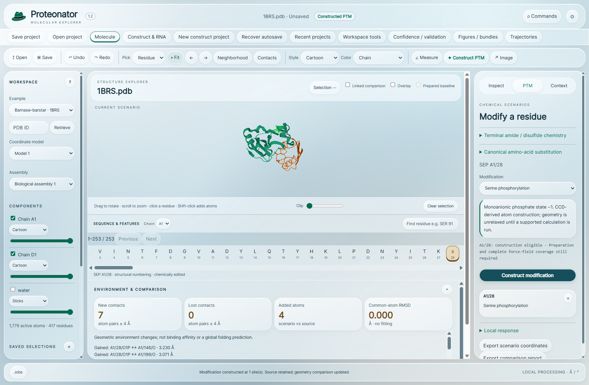
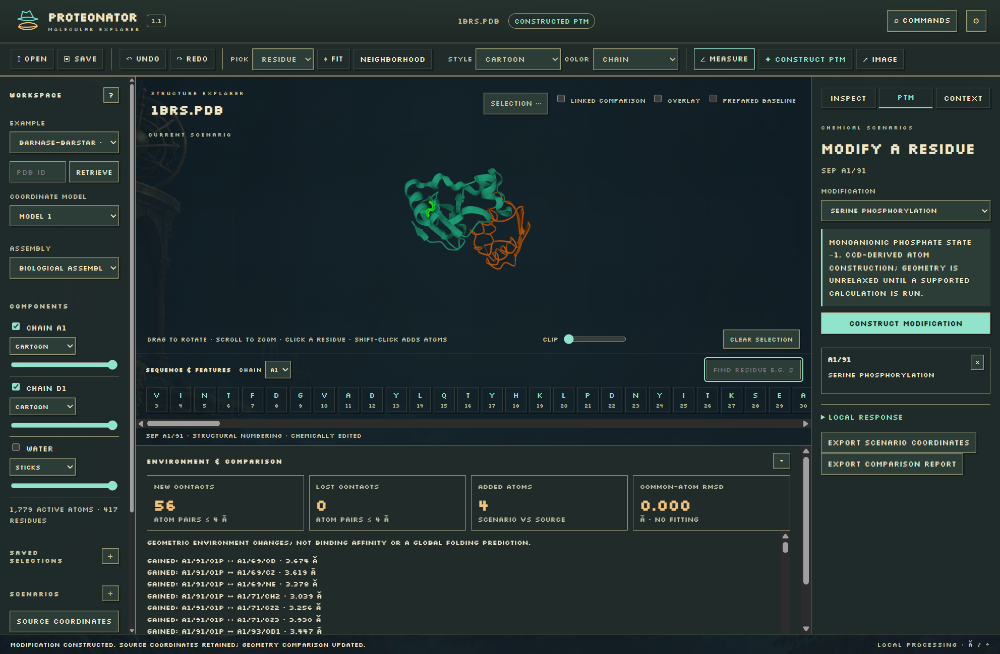

<p align="center"></p>

# Proteonator 1.2.1

**A standalone molecular and sequence workspace for protein structures, precursor designs and explicit product chemistry.**

Proteonator connects an encoded construct, its proposed processing steps, mature chemical requirements, coding RNA/DNA and supplied three-dimensional structures. Assemble sourced protein components, retain the identities of residues through virtual cleavage and maturation, and compare the resulting products without losing the original inputs. The molecular workspace lets you inspect residues and ligands, construct supported chemical scenarios and review geometric changes or a bounded local relaxation.

Everything needed for core work is included in each desktop package: scientific libraries, example structures, fonts, licenses and offline help. No separate Python installation, account or subscription is required. Online reference retrieval and checking the published version are explicit actions.

[Download for Windows, Mac and Ubuntu](https://github.com/fishhrbio/Proteonator/releases/latest) · [User guide](docs/USER_GUIDE.md) · [Scientific methods](docs/SCIENCE.md) · [Wiki](https://github.com/fishhrbio/Proteonator/wiki) · [Changelog](CHANGELOG.md) · [Roadmap](ROADMAP.md)

## See the workspace


*Midnight: real molecular coordinates, linked residue selection and a separate chemical scenario. Contact and displacement results describe geometry.*


*Construct and maturation: a generic example links encoded and processed states, explicit terminal chemistry, disulfide requirements and neutral mass calculations.*


*Coding RNA/DNA: generated coding segments remain separate from imported nucleotide records. The RNA diagram shows a calculated secondary-structure hypothesis.*


*Liquid Glass: frosted panels and luminous edges around the same local scientific tools.*


*Painted Pixels: atmospheric artwork and pixel typography, with standard readable text available in Settings.*

These are captures of the running application. Constructed chemistry and generic sequence examples are identified as proposals, not experimental observations of changed folding.

## Features

- **Construct and maturation planning:** protein/DNA/RNA imports, GenBank CDS translation, sourced/editable modules, named sequence substitutions/insertions/deletions, sourced recognition-rule checks, virtual cleavage, trimming, glycine-donor amidation, desired disulfide pairs, elemental composition, neutral masses and state-specific evidence.
- **Coding sequences and RNA:** reproducible protein back-translation under a declared genetic code, exact synonymous alternatives, supplied codon-usage policies, source CDS/codon links, local RNA folding, probabilities and two-dimensional SVG diagrams. Imported RNA-family evidence retains its actual method and thresholds.
- **Molecular inspection:** proteins, nucleic acids, ligands, ions, waters, glycans, assemblies and coordinate models; component styles, surfaces, opacity, clipping, labels and editable measurements.
- **Selection and navigation:** ranges, set operations, queries, adjustable distance neighborhoods, isolated selections, paged sequences, focus back/forward, dimmed surroundings, keyboard controls and saved views.
- **Chemical scenarios:** supported phosphorylation, acetylation, methylation and hydroxyproline construction; canonical amino-acid substitutions; bounded terminal-amide and compatible disulfide construction. Review multi-site edits, organize folders/tags/pins and preserve per-scenario undo/redo across assembly branches.
- **Comparison and evidence:** complete contact tables/CSV, typed geometric interactions, reviewed alignment tables, separate fit/evaluation regions, displacement plots, imported confidence/validation, curated features and supplied sequence/isoform comparisons.
- **Frames and communication:** topology-registered imported trajectories/ensembles, unaligned RMSD/RMSF, figure presets, transparent PNG, processing/profile SVG, readable reports, review ZIPs, saved-view storyboards and camera-presentation WebM.
- **Reliable local work:** portable compressed projects, embedded immutable sources, integrity checks, recent previews, retained recovery generations, cancellation, method/settings history, read-only inspection during calculations and three consistent skins with accessibility preferences.

## Inputs and outputs

| Area | Supported inputs |
| --- | --- |
| Structure | PDB, CIF/mmCIF; deposited assembly operators and coordinate models; optional PDB accession retrieval |
| Sequence | Declared protein, DNA or RNA text/FASTA; annotated GenBank with explicit CDS semantics |
| Maps | CCP4/MRC and supported single-dataset Cube grids; supplied frame, origin and contour settings |
| Annotations | Sequence-bound feature/domain JSON, residue-evidence JSON, RNA-analysis JSON, Infernal tblout format 1/3 and standard tRNAscan-SE tables |
| Frames | Registered trajectory JSON with exact topology hash, ordered atom identities, declared units and supplied time information |
| Project | Portable `.proteonator`, including imports of earlier `.proview` and `.ptmw` files |

Exports include mmCIF, FASTA with chemistry/method sidecars, original GenBank, full CSV/JSON, readable HTML, true vector diagrams/profiles, raster molecular PNG, WebM camera presentations and checksummed review ZIPs. A sequence alone does not create a three-dimensional structure.

## Install

Choose the package that matches your operating system and processor. Each includes the scientific runtime and offline help; no separate Python installation is required.

| System | Download | Verified target |
| --- | --- | --- |
| Windows | [Windows installer, x64](https://github.com/fishhrbio/Proteonator/releases/download/v1.2.1/Proteonator-Setup-1.2.1-x64.exe) | Windows 11 x64 |
| Mac with Apple Silicon | [macOS disk image, arm64](https://github.com/fishhrbio/Proteonator/releases/download/v1.2.1/Proteonator-1.2.1-mac-arm64.dmg) | macOS 15, Apple Silicon |
| Mac with Intel processor | [macOS disk image, x64](https://github.com/fishhrbio/Proteonator/releases/download/v1.2.1/Proteonator-1.2.1-mac-x64.dmg) | macOS 15, Intel |
| Ubuntu Linux | [Debian package, x64](https://github.com/fishhrbio/Proteonator/releases/download/v1.2.1/Proteonator-1.2.1-linux-x64.deb) | Ubuntu 22.04 and 24.04 x64 |

**Windows:** run the installer and choose a current-user destination. Start Proteonator from Start or the desktop shortcut. The installer is unsigned because no publisher signing credential is available. Close the app before upgrading. Uninstall through Windows Apps or the installed uninstaller.

**macOS:** choose the disk image for your processor, open it, then drag Proteonator into Applications. In Finder, **About This Mac** identifies an Apple chip or Intel processor. The application has an ad-hoc signature and is **not signed with an Apple Developer ID or notarized**. macOS may block first opening. If you trust the source and have checked the checksum, follow [Apple’s instructions for opening an app from an unidentified developer](https://support.apple.com/en-us/102445). A signature-integrity check does not establish Gatekeeper approval. To update, quit the app and replace the copy in Applications. To uninstall, move that copy to Trash; projects and personal settings remain.

**Ubuntu:** download the `.deb`, open a terminal in its folder and run:

```sh
sudo apt install ./Proteonator-1.2.1-linux-x64.deb
```

Open Proteonator from the applications menu, or run `proteonator`. The installer registers `.proteonator` projects and resolves desktop-library dependencies. Use the same command with the new package to update. Remove the application with `sudo apt remove proteonator`; projects and personal settings remain. Administrator permission is needed to install or remove the system package, not to run the application. Keep the normal application sandbox enabled.

Compare downloads with the [SHA-256 checksums](https://github.com/fishhrbio/Proteonator/releases/download/v1.2.1/SHA256SUMS.txt). Save copies of important projects before an upgrade. Release verification uses native operating-system hosts; virtual Mac/Linux graphics and a physical Windows computer cover the recorded checks. Linux distributions other than Ubuntu 22.04/24.04 x64, Linux ARM64, Windows ARM64 and macOS releases outside the listed test targets are not verified. Manual screen-reader testing and Apple notarization remain unavailable. Read the [installation guide](docs/USER_GUIDE.md) for retention and first-opening details.

## Start a precursor review

Choose **New construct project**. Import your actual protein or nucleotide record, then add exact, sourced components such as a fusion partner, linker, cleavage junction and target. Create the encoded construct. In **Processing**, declare the proposed cuts and mature terminal/bond requirements. Compare state identity, chemistry and mass; attach planned or observed evidence to the state it concerns. Generate coding RNA/DNA from the encoded state when that is the sequence you intend to represent. Retain a reviewed mapping before linking residues to a supplied structural chain.

For molecular work, select a residue or ligand, inspect its neighborhood and contacts, and create a separate chemical scenario. Review preparation and convergence before interpreting a local relaxation. **Commands** (`Cmd+K` on Mac, `Ctrl+K` elsewhere) finds actions; **Settings** contains skins, layouts, shortcuts and accessibility controls.

## Scientific limits

Proteonator does not predict equilibrium folding, binding affinity, expression yield or biological activity from an arbitrary edit. A local minimum, proximity contact, desired chemical state or camera movie does not establish those outcomes. Sequence mass is neutral mass, not an adduct-specific mass-to-charge measurement. Desired disulfides and amidation require experimental support for actual product identity.

Back-translation produces possible coding segments; it cannot recover original synonymous choices, UTRs, native transcript provenance or the historical tRNAs that translated a protein. RNA secondary-structure calculations do not identify RNA family or translation yield. Native Infernal/tRNAscan-SE engines and family databases are not bundled; actual external results can be imported and reviewed.

Important guards include 100,000 recorded atoms and 32 MiB per coordinate input, 5,000 atoms before hydrogen preparation for local relaxation, 10,000 amino acids per sequence state, 1,500 bases for RNA folding, 200 trajectory frames with at most 5,000 registered atoms, two maps of at most 128 MiB each, and 200 MiB expanded portable projects. Chemistry and format-specific restrictions are described in the [methods](docs/SCIENCE.md).

## Credits and license

I’m Robert Waite, an M.S. Biotechnology student at the University of South Florida. Proteonator is a small independent project I’ve been developing in my free time.

This project is independent and is not endorsed by the University of South Florida. It depends on the work of the Mol*, Gemmi, OpenMM, NumPy, Biopython, ViennaRNA, Matplotlib, wwPDB, RCSB PDB, UniProt, PDBe SIFTS and Ensembl communities. Silkscreen is by Jason Kottke. Original structure depositors retain their scientific credit.

Original Proteonator code is [MIT licensed](LICENSE). Bundled libraries, data, fonts and runtime components retain their own terms. ViennaRNA and its NAVIEW component have additional distribution restrictions; see the complete [third-party notices](THIRD_PARTY_NOTICES.md) before redistribution.
