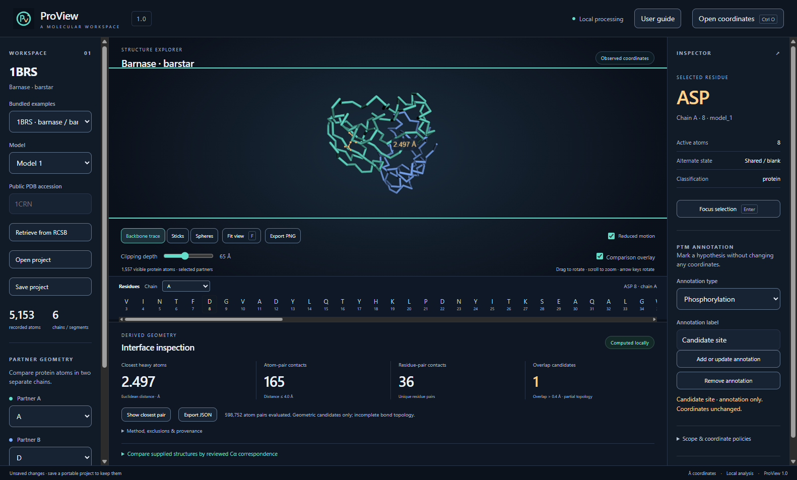
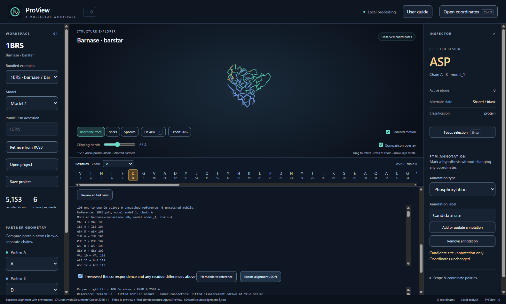
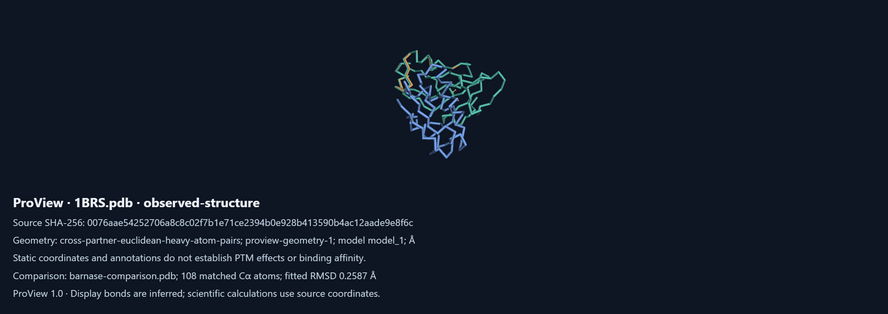

# ProView

ProView is a standalone desktop visualizer for inspecting protein structures on your own computer. Open PDB or mmCIF coordinates, explore residues in a linked 3D view and sequence strip, annotate candidate modification sites, calculate interface geometry, and compare two supplied structures using a correspondence you review yourself. Save a portable project or export results and captioned images for later inspection.

All visualization and calculations run locally. The installer includes the runtime and examples; you do not need Node.js, Python, a development server, an account, or a subscription. An optional **Retrieve from RCSB** action downloads only the public accession you enter. Local coordinate files are never uploaded.



*Barnase–barstar (1BRS): linked residue inspection and interface distances calculated from the supplied crystal coordinates. This is an actual ProView capture.*



*Reviewed Cα correspondence, an orange fitted mobile structure, and displacement markers. The mobile example is a deliberately transformed, renumbered and perturbed test copy of barnase; it is not evidence of a biological conformational change.*



*A PNG exported by ProView includes source identity, the coordinate hash, calculation context and scientific limitations.*

## Download and install

**Windows 11 x64:** [Download ProView 1.0.0 installer](https://github.com/fishhrbio/ProView-1.0/releases/download/v1.0.0/ProView-Setup-1.0.0-x64.exe). The [release page](https://github.com/fishhrbio/ProView-1.0/releases/tag/v1.0.0) also supplies SHA-256 checksums and the integrated source archive.

1. Download `ProView-Setup-1.0.0-x64.exe` and compare its SHA-256 with the release checksum file if desired: `Get-FileHash .\ProView-Setup-1.0.0-x64.exe -Algorithm SHA256`.
2. Run the installer, choose the current-user installation and destination, then install. The MIT license is included with the application. Administrator access is not required for a current-user installation.
3. Open **ProView** from the Start menu or desktop shortcut. The bundled 1BRS example opens without a connection.
4. Close ProView before reinstalling or updating. Remove ProView using Windows **Installed apps** or the installed **Uninstall ProView** program. Projects saved outside the installation folder are retained.

The Windows installer is **unsigned**. Windows may identify its publisher as unknown or show SmartScreen reputation prompts. No signing certificate has been used. Windows 11 x64 is the tested release target; Windows 10, Windows ARM64, macOS and Linux are not claimed as tested or supported by this release. A compatible graphics driver with WebGL support is required for the 3D view.

## Features

- Linked molecular viewport, residue sequence and source-identity inspector.
- Backbone trace, sticks and sphere representations; clipping, focus and keyboard view controls.
- Author and label chain/residue identity, insertion codes, multiple coordinate models and documented alternate-conformer handling.
- Editable PTM annotations that leave source coordinates unchanged.
- Cross-chain heavy-atom minimum distance, contacts within 4 Å, residue-pair contacts and geometric overlap candidates.
- Reviewed one-to-one Cα alignment with editable residue pairs, fitted RMSD, per-residue displacement and a visual overlay.
- Portable `.proview` projects containing both original sources, annotations, view state and verified results. Legacy `.ptmw` geometry projects are migrated in memory.
- Geometry and alignment JSON exports with units and provenance, and captioned viewport PNG export.
- Local user guide, keyboard controls, reduced motion, labeled controls and responsive layouts.

## Supported inputs and limits

| Input | Scope |
| --- | --- |
| `.pdb`, `.ent` | Fixed-column ATOM/HETATM coordinates, MODEL blocks, insertion codes, alternate locations and explicit CONECT records |
| `.cif`, `.mmcif` | Coordinate-bearing PDBx/mmCIF atom_site loops, author/label identity and multiple models |
| `.proview` | Portable ProView projects, schema 2.0.0, with embedded source and result revalidation |
| `.ptmw` | Legacy schema 1.0.0 geometry projects; save as `.proview` after opening |
| RCSB accession | Explicit retrieval of a four-character PDB accession as mmCIF; a connection is required for this action |

Coordinate inputs are limited to 5 MiB and 25,000 recorded atoms per structure, projects to 50 MiB, geometry to 25 million cross-partner pairs and 100,000 output pair records. Operations fail visibly at these limits instead of silently truncating results. The parser does not implement the entire mmCIF dictionary, BinaryCIF, PDB hybrid-36 numbering or multiple coordinate data blocks. FASTA sequences and trajectories are not coordinate inputs.

## Use ProView

Open coordinates or choose a bundled example. Choose a coordinate model and two protein chains. Click a residue in the molecule or sequence to inspect its original identity, then add, edit or remove an annotation. **Calculate interface** evaluates the selected source coordinates; **Show closest pair** draws the measured atom pair.

Expand **Compare supplied structures**, open the mobile coordinates, and choose a chain and model in each structure. **Propose Cα pairs** finds exact identities. For different numbering, edit the two-column residue-pair list and select **Review edited pairs**. Resolve missing, duplicate or ambiguous pairs, confirm your review and fit. The mobile structure is displayed in orange with true-scale displacement connectors (up to 500); the numeric report includes every fitted residue. Correspondence is explicit, without sequence alignment or automatic homology inference.

Use **Save project** to retain the original inputs, comparison and workspace offline. **Export JSON**, **Export alignment JSON** and **Export PNG** create separate reports. See the [user guide](docs/USER_GUIDE.md) for policies, keyboard controls and troubleshooting.

## Scientific limitations

ProView describes supplied static coordinates. Contacts, fitted displacements, annotations and overlap candidates do not establish binding affinity, energetics, PTM effects, biological causality or clinical significance. An annotation adds a label, not atoms or chemical modifications. Missing atoms and residues are not reconstructed.

The viewport shows active canonical-protein atoms in the selected partner chains. Waters, ligands, unsupported modified residues and non-protein polymers are retained in project inputs and normalized data but hidden in this protein view and excluded from interface calculations. Heavy-atom contacts use an inclusive 4.0 Å cutoff. Overlap candidates use the Bondi C/N/O/S/P radius subset and a strict overlap greater than 0.4 Å, with a 10⁻¹² Å boundary tolerance. Known explicit CONECT 1–2 and 1–3 neighbors are excluded from overlaps; the bond graph remains incomplete. This is not a validated clashscore. Display bonds are inferred visual aids and do not enter the scientific calculations.

Alignment uses only the pairs you review. A mathematically small RMSD does not validate correspondence. The fit is a proper rigid rotation and translation, without reflection, scale, coordinate optimization or source-coordinate replacement. [Methods and validation](docs/SCIENCE.md) describes the calculations and independent checks.

## Credits

I’m Robert Waite, an M.S. Biotechnology student at the University of South Florida. ProView is a small independent project I’ve been developing in my free time.

ProView is an independent project and is not endorsed by or affiliated with the University of South Florida. Thanks to the authors and maintainers of [3Dmol.js](https://3dmol.org/), [Electron](https://www.electronjs.org/), [Zod](https://zod.dev/) and the [wwPDB/RCSB archive](https://www.rcsb.org/) for the visualization tools, runtime, validation library and public example structures. The experimental structures remain credited to their original depositors. See [third-party notices](THIRD_PARTY_NOTICES.md) and [fixture provenance](fixtures/README.md).

ProView's original code and icon are released under the [MIT license](LICENSE).

## Build from source

Use Node.js 24.22.1 and pnpm 11.25.0. On Windows, use a short checkout path (for example, `C:\src\ProView`) because NSIS build tools have path-length limits. From the repository root:

```text
pnpm install --frozen-lockfile
pnpm setup:electron
pnpm typecheck
pnpm test
pnpm schemas
pnpm build
pnpm start
```

`pnpm dist:win` builds a Windows x64 installer without publishing. `pnpm test:release` runs the desktop release suite. `pnpm verify:numerical` uses Python 3 for an independent reference calculation. The optional Gemmi/NumPy comparison uses Python 3.12 with `requirements-verification.txt` and `pnpm test:independent`. Build and test dependencies are separate from the installed app. Platform and test evidence is recorded in [release verification](docs/VERIFICATION.md).
