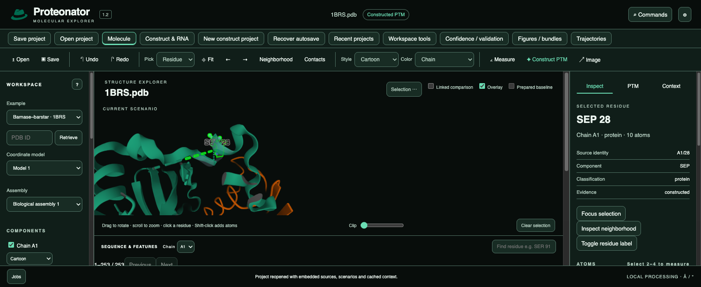
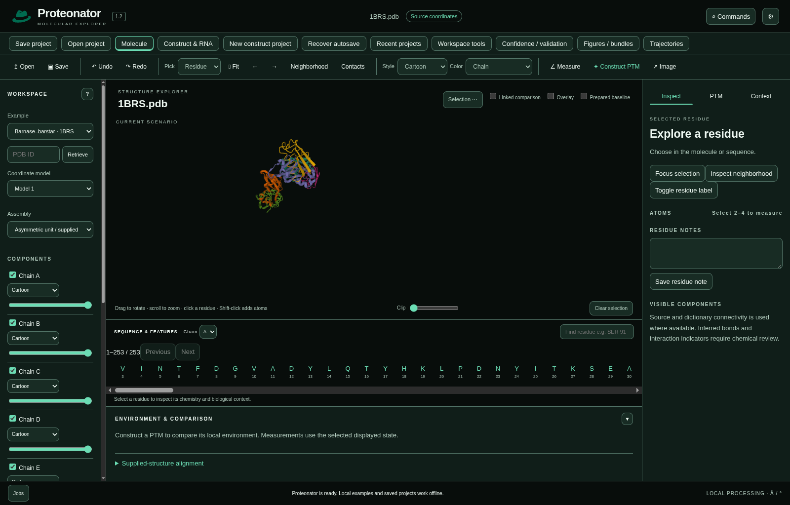

# Desktop platforms

Proteonator 1.2.1 includes native application packages and scientific runtimes for the targets below. Choose a download on the [release page](https://github.com/fishhrbio/Proteonator/releases/tag/v1.2.1), and compare its SHA-256 checksum before installing. No separate Python installation is required.

| Target | Package | Verification |
| --- | --- | --- |
| Windows 11, x64 | Current-user installer | 106 application checks; final package checks; fresh installation, upgrade from 1.2.0, reinstall and uninstall retention |
| macOS 15, Apple Silicon | arm64 disk image | 106 application checks; native opening, offline help and installation lifecycle |
| macOS 26, Apple Silicon | The same arm64 disk image | 106 application checks; native opening, offline help and installation lifecycle |
| macOS 15, Intel | x64 disk image | 106 application checks; native opening, offline help and installation lifecycle |
| macOS 26, Intel | Outside the release-verified scope | Acceptance incomplete when the release scope was frozen |
| Ubuntu 22.04, x64 | Debian package | 106 application checks; native opening, offline help and installation lifecycle |
| Ubuntu 24.04, x64 | The same Debian package | 106 application checks; native opening, offline help and installation lifecycle |

The application checks cover structures and sequences, supported chemistry, alignment, project save/reopen and recovery, exports, keyboard interaction, automated accessibility and offline work. Installation checks use the actual packaged application, open projects through the operating system, reinstall it, remove it and confirm that project and settings files retain their hashes. Exported movies are decoded independently; review ZIPs receive CRC and content-hash checks. The application sandbox remains enabled.

The native package hosts also passed 75 source tests and 29 Python tests. Four bounded local-response examples check chemistry, charge, energy decrease and stereochemistry. Phosphoserine additionally receives independent CPU/Reference energy and force comparisons and a finite-difference check. The acetyllysine example and its control reach the 200-iteration limit without convergence; that condition remains explicit in their results. These checks do not validate global folding, affinity, biological activity or expression yield.

## Native workspace captures

*Proteonator on a native Apple Silicon macOS host, showing the 1BRS biological assembly and a separately constructed phosphoserine scenario. The narrow capture reflects the verification host's display dimensions.*

*Proteonator installed from the Debian package on Ubuntu, showing the same local molecular workspace and emerald fedora identity.*

## Signing and test boundaries

Mac applications have ad-hoc signatures whose integrity checks passed. They have no Apple Developer ID signature or notarization. The recorded Gatekeeper assessment rejected them; Gatekeeper approval is not a passed check. If you trust the download, follow [Apple's documented first-opening procedure](https://support.apple.com/en-us/102445). Do not disable operating-system protections globally. The Windows installer is unsigned because a publisher credential is unavailable.

Windows checks ran on a physical Windows computer. Mac and Ubuntu checks ran on native operating-system virtual hosts. Apple Silicon used the host's paravirtualized Metal graphics; Intel Mac used SwiftShader because its host did not expose a Metal device. Ubuntu used an X11 display with software rendering. Physical Intel Mac GPUs, Wayland sessions and manual screen-reader interaction were not tested. Automated accessibility checks do not substitute for a manual screen-reader review.

Other macOS versions, other Linux distributions, Linux ARM64 and Windows ARM64 are unverified. There is no AppImage or RPM download. The Ubuntu package is a system installation; running the application itself does not require administrator privileges.

## Verification records

- [Native scientific validation and package records](https://github.com/fishhrbio/Proteonator/actions/runs/43565711054): all three scientific-validation steps passed.
- [macOS 15 Apple Silicon](https://github.com/fishhrbio/Proteonator/actions/runs/43565711054/job/132358992371) and [Ubuntu 22.04](https://github.com/fishhrbio/Proteonator/actions/runs/43565711054/job/132358992594) installation and application acceptance.
- [Intel macOS 15 acceptance retest](https://github.com/fishhrbio/Proteonator/actions/runs/43568965800).
- [macOS 26 Apple Silicon](https://github.com/fishhrbio/Proteonator/actions/runs/43565711050/job/132363771691) and [Ubuntu 24.04](https://github.com/fishhrbio/Proteonator/actions/runs/43565711050/job/132363771689), using the same respective packages.
- Separate, incomplete [Intel macOS 26 sequential acceptance retest](https://github.com/fishhrbio/Proteonator/actions/runs/43569784695).

The records concern the exact package bytes listed in the release checksums. Each verified target receives 106 application checks, independent movie decoding and ZIP validation, plus native opening, offline help and installation lifecycle checks. Intel records include focused retests after UI automation timeouts; graphics-heavy application instances are tested sequentially on these hosts. Previously passed suites are retained only when the installer SHA-256 matches; unfinished checks and native installation/export checks are rerun. Existing 1.2.0 downloads remain available.
