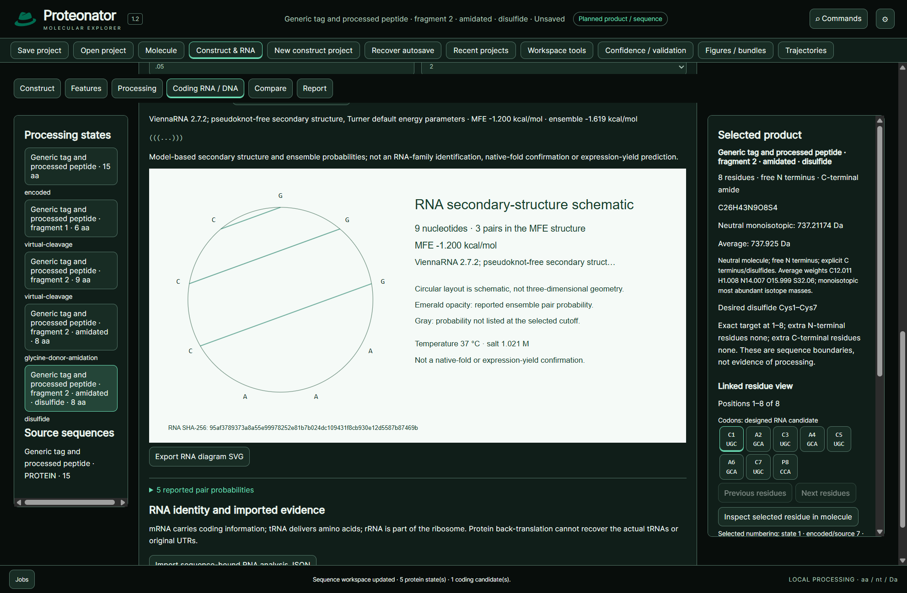

# Coding sequences and RNA

Back-translation generates possible coding RNA/DNA for the selected protein state. Use the encoded construct when removed tags or maturation extensions need to be encoded. Generated candidates are designed coding segments, not recovered native transcripts.

Choose a versioned genetic code and deterministic, seeded or explicitly sourced codon-usage policy. Exact synonymous alternatives, encoding count, seed and settings are retained. Every candidate retranslates exactly. Frequency matching does not demonstrate expression optimization. Context-dependent recoding tables are explicitly unavailable.

Complete supplied CDS translation requires declared initiation and terminal-stop rules. Internal segments do not receive fabricated starts/stops. Source codon positions remain tied to actual nucleotide records, strand and stable protein identities.

Protein alone cannot reveal synonymous choices, UTRs, introns, splice boundaries, native promoters, caps/poly(A), original source organism or historical translating tRNAs. RNA-family identity is a separate evidence problem; an ORF is not proof of mRNA role.

ViennaRNA secondary structure uses explicit temperature/salt/dangles/lonely-pair/probability settings and at most 1,500 unambiguous bases. MFE/ensemble energies and probabilities are predictions; the circular SVG is schematic rather than three-dimensional or expression-yield evidence.

Import actual RNA-family evidence through sequence-bound JSON, Infernal cmsearch/cmscan tblout 1/3 or standard tRNAscan-SE tables. Retain analyzed-sequence hash, method/version/settings, database/threshold policy, intervals, strand and ambiguity. No hits remain unresolved. Native family engines/databases are not bundled.

*Calculated secondary structure for an explicitly supplied RNA sequence; it does not identify the RNA's biological family.*

Synonymous candidate comparison requires the same exact translated protein and shows codon changes, GC and declared usage weights. U/T alphabet differences are normalized for codon identity. Export the full CSV; no expression-optimization score is inferred.
