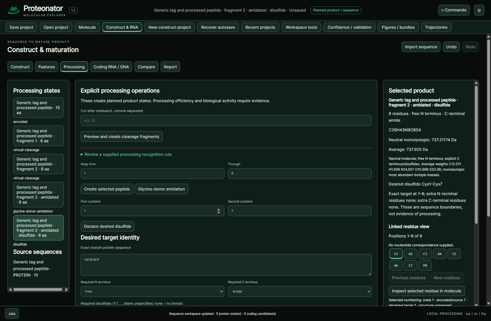

# Construct and maturation

Import the actual protein, DNA/RNA FASTA or annotated GenBank record. Keep molecule type, origin and biological role separate. GenBank CDS parsing retains source coordinates/strand and reports annotation conflicts; it does not repair unsupported recoding or invent missing sequence.

Add exact sourced components such as a fusion partner, linker, cleavage junction, target and maturation extension. Reorder components and create the encoded construct. Component names do not independently establish identity. A sequence-only project has no fabricated coordinates.

In Processing, declare cuts after one-based residue positions. Fragments retain residue identities. Trimming is distinct from glycine-donor amidation, which removes terminal glycine and explicitly creates an amidated product. Desired disulfides pair unpaired cysteines. Cross-fragment covalent pairing prevents a simple independent-fragment interpretation.

Specify target sequence and terminal/bond requirements. Exact sequence match, declared design compliance and experimental product identity are separate. The inspector reports formula and neutral monoisotopic/average mass. Keep chemistry metadata beside FASTA.

Attach planned, observed or interpreted evidence to its actual state. Evidence for sequence does not automatically establish cleavage, termini, pairing, purity or activity. A reviewed source/model/assembly mapping is required before residues link to a supplied structural chain. Mapped substitutions reconstruct side chains in a retained backbone; missing regions are not modeled.

*Generic processing/chemistry illustration, not a measured production construct or expression-yield prediction.*

Named replacements/insertions/deletions create separate sequence states with a declared difference track and fresh chemistry/mapping review. Editing a component set does not mutate an earlier encoded construct; reassemble for the new state. Supplied processing motifs require a reagent/rule name, cut offset, source/version and context. Literal motif matches and desired cuts are design checks, not confirmed cleavage or processing efficiency. Target-boundary text exposes extra N/C residues and repeated/ambiguous targets.
