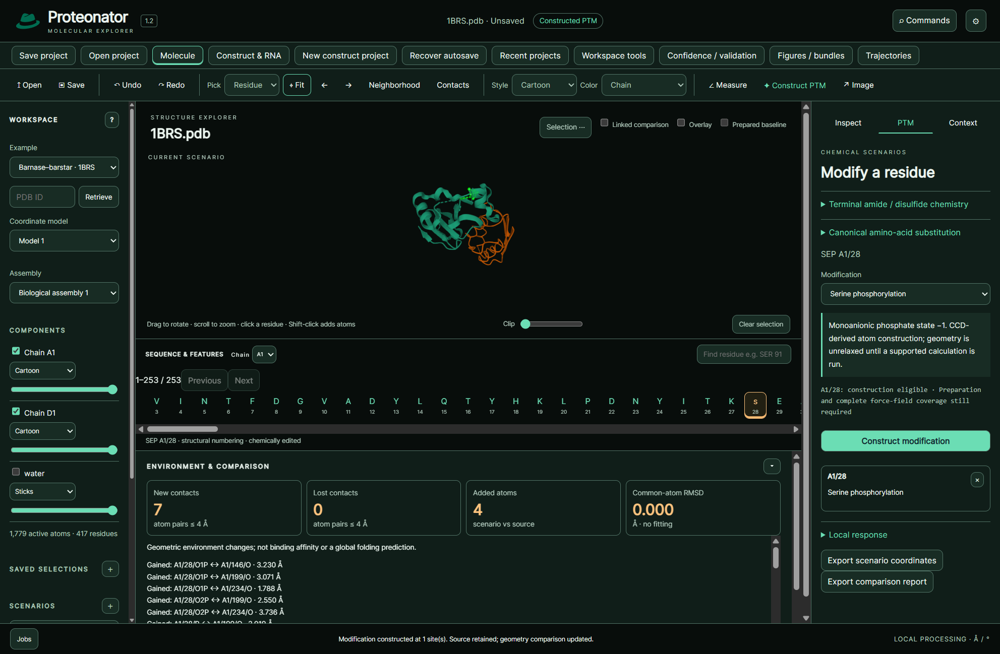

# Proteonator

Proteonator is a local workspace for supplied molecular structures, precursor designs, explicit mature chemistry and reproducible scientific comparisons. Version 1.2 links encoded constructs, processing states, coding RNA/DNA and reviewed structural correspondence without inventing a new fold from sequence.

Start with [[Getting-started]], [[Construct-and-maturation]] or [[Molecular-inspection]]. See [[Coding-sequences-and-RNA]] for translation/secondary structure, [[PTM-scenarios]] for chemical edits, and [[Projects-and-scientific-interpretation]] for evidence limits.

*The running application with real molecular coordinates and a separate constructed scenario. Geometry is not a measurement of affinity.*

[Windows installer](https://github.com/fishhrbio/Proteonator/releases/latest) · [Full user guide](https://github.com/fishhrbio/Proteonator/blob/main/docs/USER_GUIDE.md) · [Scientific methods](https://github.com/fishhrbio/Proteonator/blob/main/docs/SCIENCE.md) · [Roadmap](https://github.com/fishhrbio/Proteonator/blob/main/ROADMAP.md)
